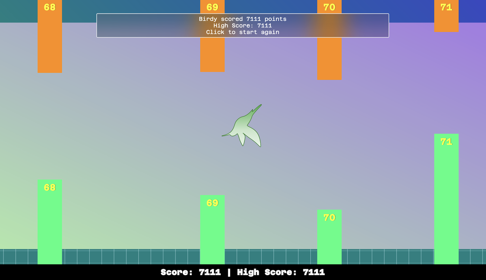

# Birdy Game

  

Birdy Game is a browser-based arcade game inspired by Flappy Bird. Your task is to control a hummingbird as it navigates through a series of moving pipes, aiming to achieve the highest score possible. This version emphasizes the underlying game logic while delivering a lightweight yet engaging experience with a charming retro aesthetic. Proudly built without external libraries or frameworks, it is especially appealing to developers who appreciate lean, self-contained projects.

The game demonstrates essential browser-game techniques such as frame-based animation, keyboard and pointer input handling, gravity and velocity simulation, procedural obstacle movement, score tracking, and collision detection. A continuous game loop driven by `requestAnimationFrame()` updates the bird’s position, moves the pipes, checks for intersections between objects, and redraws the scene in synchronization with the browser’s refresh cycle. Simple state management controls transitions between the start screen, active gameplay, and game-over state.

It remains fascinating how much functionality can be packed into a single HTML file to create a standalone game. By combining HTML for structure, CSS for presentation, and JavaScript for rendering and gameplay logic, Birdy Game requires no build tools, dependencies, or server-side components: open the file in a modern browser and start playing. It is both a compact arcade experience and a practical demonstration of how core web technologies can power a complete interactive application.

## Visuals

## License

This project is licensed under the MIT License - see the [LICENSE](LICENSE) file for details.

## Contact

Maintained by tpreisig - feel free to reach out!
